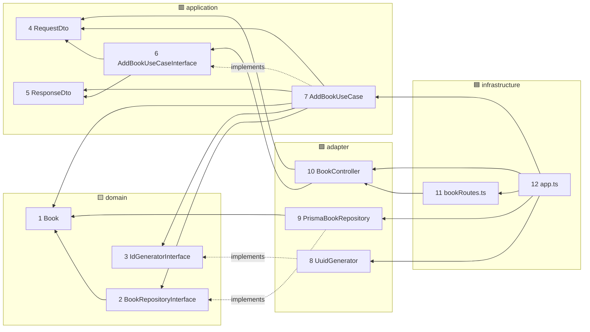
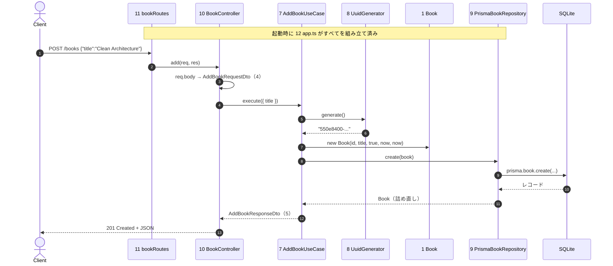

# 書籍登録（addBook）をファイルごとに読む

`POST /books` で書籍を登録する機能を例に、クリーンアーキテクチャの**各ファイルが何を担当しているのか**を 1 ファイルずつ解説する。

全体像や各層の概要は [クリーンアーキテクチャ まとめ](clean-architecture.md) を参照。

---

## 0. 登場するファイル一覧

addBook に関わるファイルは 12 個（+ Prisma スキーマ）。

| # | 層 | ファイル（`clean/src/` 以下） | ひとことで言うと |
| --- | --- | --- | --- |
| 1 | 🟨 domain | `domain/entities/book.ts` | 「書籍とは何か」 |
| 2 | 🟨 domain | `domain/repositories/bookRepositoryInterface.ts` | 「書籍を保存できること」の契約 |
| 3 | 🟨 domain | `domain/utils/idGeneratorInterface.ts` | 「ID を作れること」の契約 |
| 4 | 🟥 application | `application/dtos/book/addBookRequestDto.ts` | ユースケースの入力の形 |
| 5 | 🟥 application | `application/dtos/book/addBookResponseDto.ts` | ユースケースの出力の形 |
| 6 | 🟥 application | `application/usecases/book/addBookUseCaseInterface.ts` | ユースケースの入口の契約（Input Port） |
| 7 | 🟥 application | `application/usecases/book/addBookUseCase.ts` | 「書籍を登録する」手順の本体（Interactor） |
| 8 | 🟩 adapter | `adapter/utils/uuidGenerator.ts` | ③ の実装（uuid ライブラリ） |
| 9 | 🟩 adapter | `adapter/repositories/prismaBookRepository.ts` | ② の実装（Prisma） |
| 10 | 🟩 adapter | `adapter/controllers/bookController.ts` | HTTP ⇔ ユースケースの変換 |
| 11 | 🟦 infrastructure | `infrastructure/web/routers/bookRoutes.ts` | URL とコントローラの対応付け |
| 12 | 🟦 infrastructure | `infrastructure/web/app.ts` | 全部を組み立てて起動する |

このドキュメントでは**内側（domain）から外側（infrastructure）の順**に読む。内側のファイルは外側を知らないので、この順なら「まだ読んでいないファイル」が出てこない。



> 矢印は「import している（知っている）」の向き。すべて右（内側）に向かっている。

---

## 🟨 Domain 層

### 1. `domain/entities/book.ts` — 書籍エンティティ

```ts
export class Book {
    constructor(
        private _id: string,
        private _title: string,
        private _isAvailable: boolean = true,
        private _createdAt: Date = new Date(),
        private _updatedAt: Date = new Date()
    ) {}

    get id(): string { return this._id; }
    get title(): string { return this._title; }
    get isAvailable(): boolean { return this._isAvailable; }
    get createdAt(): Date { return this._createdAt; }
    get updatedAt(): Date { return this._updatedAt; }

    loan() {
        if (!this._isAvailable) {
            throw new Error("Book is not available for loan.");
        }
        this._isAvailable = false;
        this._updatedAt = new Date();
    }

    return() { /* loan の逆 */ }
}
```

**役割**：アプリの中心にある「書籍」という概念そのもの。データと、そのデータに関するルールをひとまとめにする。

**ポイント**

| 書き方 | 意図 |
| --- | --- |
| フィールドを `private _xxx` にする | 外から `book._isAvailable = false` のように勝手に書き換えさせない |
| getter だけを公開する | 読むのは自由、変更は決められたメソッド経由だけ |
| `loan()` / `return()` に状態チェックを書く | 「貸出中の本は貸し出せない」というルールを**本の中に閉じ込める**。どのユースケースから呼ばれても必ずこのルールが守られる |
| `import` が 1 つもない | DB・Web・ライブラリのどれにも依存しない。純粋な TypeScript だけで書かれている |

**addBook での使われ方**：UseCase が `new Book(...)` で新しい本を作る。Repository が DB から取り出したデータを `Book` に詰め直す。

**ここに書かないもの**：DB への保存処理、JSON への変換、HTTP ステータスなど。

---

### 2. `domain/repositories/bookRepositoryInterface.ts` — リポジトリの契約

```ts
import { Book } from "../entities/book";

export interface BookRepositoryInterface {
    create(book: Book): Promise<Book>;
    findById(id: string): Promise<Book | null>;
}
```

**役割**：「書籍を保存したり取り出したりできるもの」が満たすべき**約束（契約）**だけを書く。どうやって保存するかは書かない。

**ポイント**

- 引数も戻り値も `Book`（ドメインの型）。Prisma の型や SQL はまったく出てこない。
- **なぜ domain 層に置くのか**：これがクリーンアーキテクチャのいちばん大事なところ。
  UseCase は「保存したい」が、DB（外側）に依存してはいけない。そこで、**内側に「保存できる何か」の型を置き、外側にそれを実装させる**。こうすると import の矢印が外 → 内に揃う（依存性逆転の原則）。

```
  AddBookUseCase ──▶ BookRepositoryInterface ◀── PrismaBookRepository
   (application)         (domain)                    (adapter)
```

- `Promise` を返すのは、保存先が DB でも API でもメモリでも対応できるようにするため。

---

### 3. `domain/utils/idGeneratorInterface.ts` — ID 生成の契約

```ts
export interface IdGeneratorInterface {
    generate(): string;
}
```

**役割**：「文字列の ID を 1 つ作れるもの」の契約。

**ポイント**

- `uuid` ライブラリを UseCase で直接 `import` すると、UseCase が外部ライブラリに依存してしまう。インターフェースを挟むことで、UseCase は「ID を作れる何か」だけを知っていればよくなる。
- **テストが楽になる**：本物の UUID は毎回ランダムなので、テストで結果を比較しにくい。インターフェースなら、テストでは常に `"test-id"` を返すモックに差し替えられる。

```ts
// テストでの例
const fakeIdGenerator: IdGeneratorInterface = { generate: () => "test-id" };
```

---

## 🟥 Application 層

### 4. `application/dtos/book/addBookRequestDto.ts` — 入力 DTO

```ts
export interface AddBookRequestDto {
    title: string;
}
```

**役割**：「書籍を登録する」ユースケースが**受け取るデータの形**を決める。

**ポイント**

- DTO = Data Transfer Object。層の境界をまたいでデータを運ぶための入れ物。ロジックは持たない。
- `id` や `isAvailable` は含まない。それらは**ユースケース側が決める**ものなので、呼び出し側には渡させない。
- Express の `req.body` をそのまま UseCase に渡さないのがポイント。UseCase は「HTTP から呼ばれた」ことを知らなくてよい（CLI やバッチから呼ばれても同じ DTO を作れば動く）。

---

### 5. `application/dtos/book/addBookResponseDto.ts` — 出力 DTO

```ts
export interface AddBookResponseDto {
    id: string;
    title: string;
    isAvailable: boolean;
    createdAt: Date;
    updatedAt: Date;
}
```

**役割**：ユースケースが**返すデータの形**を決める。

**ポイント**

- `Book` エンティティそのものではなく、**ただのデータ（プレーンなオブジェクト）**を返す。
- **なぜ Book をそのまま返さないのか**
  - `Book` を返すと、Controller から `book.loan()` が呼べてしまう。外側の層に業務ルールを操作させたくない。
  - `Book` のフィールドを変えたとき、レスポンスの形まで勝手に変わってしまうのを防ぐ。
  - 「外に見せる項目」を DTO で明示的に選べる（例：将来 `Book` に内部用のフィールドが増えても、DTO に書かなければ外には出ない）。

---

### 6. `application/usecases/book/addBookUseCaseInterface.ts` — 入口の契約（Input Port）

```ts
import { AddBookRequestDto } from "../../dtos/book/addBookRequestDto";
import { AddBookResponseDto } from "../../dtos/book/addBookResponseDto";

export interface AddBookUseCaseInterface {
    execute(requestDto: AddBookRequestDto): Promise<AddBookResponseDto>;
}
```

**役割**：「書籍を登録する」ユースケースの**呼び出し方**を決める。クリーンアーキテクチャの図でいう **Use Case Input Port**。

**ポイント**

- Controller は `AddBookUseCase`（実装クラス）ではなく、このインターフェースに依存する。
- そのため Controller のテストでは、UseCase をモックに差し替えられる（DB なしで Controller だけをテストできる）。
- メソッド名を `execute` 1 つにしているのは「1 ユースケース = 1 クラス = 1 つの操作」というルールのため。ユースケースが増えたらクラスを増やす。

---

### 7. `application/usecases/book/addBookUseCase.ts` — ユースケース本体（Interactor）

```ts
export class AddBookUseCase implements AddBookUseCaseInterface {
    constructor(
        private readonly bookRepository: BookRepositoryInterface,
        private readonly idGenerator: IdGeneratorInterface
    ) {}

    async execute(requestDto: AddBookRequestDto): Promise<AddBookResponseDto> {
        // ① ID を発行する
        const id = this.idGenerator.generate();
        // ② エンティティを作る
        const newBook = new Book(id, requestDto.title, true, new Date(), new Date());
        // ③ 保存する
        const createdBook = await this.bookRepository.create(newBook);
        // ④ DTO に詰め替えて返す
        return {
            id: createdBook.id,
            title: createdBook.title,
            isAvailable: createdBook.isAvailable,
            createdAt: createdBook.createdAt,
            updatedAt: createdBook.updatedAt
        };
    }
}
```

**役割**：「書籍を登録する」という**アプリの手順**を書く。図でいう **Use Case Interactor**。

**処理の流れ**

| ステップ | 何をしているか | 使っているもの |
| --- | --- | --- |
| ① | ID を発行 | `IdGeneratorInterface`（中身が uuid かは知らない） |
| ② | 新しい本は「貸出可能（`true`）」で作る | `Book` エンティティ |
| ③ | 保存 | `BookRepositoryInterface`（中身が Prisma かは知らない） |
| ④ | エンティティ → Response DTO | `AddBookResponseDto` |

**ポイント**

- **コンストラクタで依存を受け取る（コンストラクタインジェクション）**。自分の中で `new PrismaBookRepository()` しない。何を渡すかは外側（`app.ts`）が決める。
- 型はすべてインターフェース。このファイルの `import` を見ると、**domain と application のファイルしか出てこない**。これが「内側は外側を知らない」の実例。
- Entity と UseCase の違い
  - **Entity（`Book`）**：「貸出中は貸し出せない」のような、どのアプリでも変わらない本質的なルール
  - **UseCase**：「ID を振って、作って、保存して、返す」という、このアプリでの作業手順

---

## 🟩 Adapter 層

### 8. `adapter/utils/uuidGenerator.ts` — ID 生成の実装

```ts
import { v4 as uuidv4 } from 'uuid';
import { IdGeneratorInterface } from '../../domain/utils/idGeneratorInterface';

export class UuidGenerator implements IdGeneratorInterface {
    generate(): string {
        return uuidv4();
    }
}
```

**役割**：3 の契約を、`uuid` という外部ライブラリを使って実現する。

**ポイント**

- 外部ライブラリ（`uuid`）を `import` しているのは**このファイルだけ**。ライブラリを替えたい（例：`crypto.randomUUID()` や ULID に変える）ときは、このファイルだけ直せばよい。
- `implements IdGeneratorInterface` により、契約どおりのメソッドがないとコンパイルエラーになる。

---

### 9. `adapter/repositories/prismaBookRepository.ts` — 永続化の実装（Gateway）

```ts
export class PrismaBookRepository implements BookRepositoryInterface {
    constructor(private readonly prisma: PrismaClient) {}

    async create(book: Book): Promise<Book> {
        // Entity → DB レコード
        const createdBook = await this.prisma.book.create({
            data: {
                id: book.id,
                title: book.title,
                isAvailable: book.isAvailable,
                createdAt: book.createdAt,
                updatedAt: book.updatedAt
            }
        });

        // DB レコード → Entity
        return new Book(
            createdBook.id,
            createdBook.title,
            createdBook.isAvailable,
            createdBook.createdAt,
            createdBook.updatedAt
        );
    }
    // findById は省略
}
```

**役割**：2 の契約を Prisma で実現する。図でいう **Gateways**。

**ポイント**

- **変換が 2 回ある**
  - 保存するとき：`Book` → Prisma 用のオブジェクト（`book.id` などの getter で取り出す）
  - 返すとき：Prisma の戻り値 → `new Book(...)` で詰め直す
- Prisma の戻り値をそのまま返さないのは、UseCase に Prisma の型を漏らさないため。UseCase が受け取るのは常に `Book`。
- `PrismaClient` もコンストラクタで受け取る。テスト用 DB の Prisma を渡す、といった差し替えができる。
- DB のテーブル定義は `clean/prisma/schema.prisma` の `model Book`。Entity と DB のカラム名が同じなので変換は素直だが、**別々に変更できる**のがこの層があるメリット（例：DB 側だけ `is_available` に変えても、このファイルの変換を直すだけで済む）。

---

### 10. `adapter/controllers/bookController.ts` — コントローラ（`add` メソッド）

```ts
export class BookController {
    constructor(
        private readonly addBookUseCase: AddBookUseCaseInterface,
        private readonly findBookByIdUseCase: FindBookByIdUsecaseInterface
    ) {}

    async add(req: Request, res: Response): Promise<void> {
        try {
            // HTTP → Request DTO
            const requestDto: AddBookRequestDto = {
                title: req.body.title
            };
            // ユースケース実行
            const book = await this.addBookUseCase.execute(requestDto);
            // Response DTO → HTTP
            res.status(201).json(book);
        } catch (error) {
            console.log(error);
            res.status(500).json({ error: "Failed to add book" });
        }
    }
}
```

**役割**：**HTTP の世界とユースケースの世界の通訳**。図でいう **Controllers**（このプロジェクトでは Presenter の役割も兼ねている）。

**処理の流れ**

| ステップ | 変換 |
| --- | --- |
| 入力 | `req.body.title` → `AddBookRequestDto` |
| 実行 | `addBookUseCase.execute()` |
| 出力（成功） | `AddBookResponseDto` → `201 Created` + JSON |
| 出力（失敗） | 例外 → `500` + エラーメッセージ |

**ポイント**

- 依存しているのは `AddBookUseCaseInterface`（インターフェース）。実装クラスは知らない。
- `201` や `500` などの HTTP ステータスを知っているのは**この層だけ**。UseCase は HTTP を知らない。
- 業務ロジックは書かない。Controller に `if (title.length > 100)` のような業務ルールを書き始めたら、それは Entity か UseCase に移すべきサイン。

> 💡 **改善できる点**：今は `title` が未指定でもそのまま UseCase に渡り、DB の NOT NULL 制約で落ちて `500` になる。本来は入力不備なので `400 Bad Request` を返すのが適切。形式チェック（必須か・文字列か）は Controller で、業務的な制約（タイトルの文字数上限など）は Entity でチェックするのがよい。

---

## 🟦 Infrastructure 層

### 11. `infrastructure/web/routers/bookRoutes.ts` — ルーティング

```ts
export function bookRoutes(bookController: BookController) {
  const router = Router();

  router.post('/', bookController.add.bind(bookController));
  router.get('/:id', bookController.findById.bind(bookController));

  return router;
}
```

**役割**：「どの URL・どの HTTP メソッドで、どの Controller のメソッドを呼ぶか」を Express に登録する。

**ポイント**

- Express の `Router` を使っているので、フレームワークそのものの層（Frameworks & Drivers）に置く。
- Controller を引数で受け取る。このファイルの中で `new BookController()` はしない。
- **`.bind(bookController)` が必要な理由**：`bookController.add` をそのまま渡すと、Express が呼び出すときに `this` が `undefined` になり、`this.addBookUseCase` にアクセスできずにエラーになる。`bind` で `this` を `bookController` に固定している。（アロー関数 `(req, res) => bookController.add(req, res)` でも同じ効果）

---

### 12. `infrastructure/web/app.ts` — 組み立てと起動（Composition Root）

```ts
const app = express();
app.use(express.json());

// ── 具象クラスを作る ──
const prisma = new PrismaClient();
const uuidGenerator = new UuidGenerator();

// ── 内側の部品に外側の実装を注入しながら組み立てる ──
const bookRepository = new PrismaBookRepository(prisma);
const addBookUseCase = new AddBookUseCase(bookRepository, uuidGenerator);
const findBookByIdUseCase = new FindBookByIdUsecase(bookRepository);
const bookController = new BookController(addBookUseCase, findBookByIdUseCase);

// ── ルーティングを登録して起動 ──
app.use('/books', bookRoutes(bookController));
app.listen(PORT, ...);
```

**役割**：アプリの**すべての部品を `new` して組み立て、サーバを起動する**場所。

**ポイント**

- **すべての層を `import` してよい唯一の場所**。ここだけは「どの実装を使うか」という具体的な判断をする。
- 組み立ての順番は**依存される側から**。
  `PrismaClient` / `UuidGenerator` → `PrismaBookRepository` → `AddBookUseCase` → `BookController` → ルーター
- `express.json()` は、リクエストボディの JSON を `req.body` に変換するミドルウェア。これがないと Controller で `req.body.title` が読めない。
- **差し替えの例**：DB を PostgreSQL 用の別リポジトリに替えたいなら、変えるのはこの 1 行だけ。

```ts
const bookRepository = new PostgresBookRepository(pool); // ← ここだけ変える
// AddBookUseCase も BookController も一切変更不要
```

---

## まとめ：リクエスト 1 回分を通しで追う

`POST /books` に `{"title": "Clean Architecture"}` を送ったとき。



### データの形の移り変わり

| 場所 | データの形 | 変換しているファイル |
| --- | --- | --- |
| HTTP リクエスト | `{"title": "Clean Architecture"}`（JSON 文字列） | `app.ts`（`express.json()`） |
| Controller 内 | `req.body`（Express のオブジェクト） | `bookController.ts` |
| UseCase の入力 | `AddBookRequestDto` | `addBookUseCase.ts` |
| UseCase 内 | `Book` エンティティ | `prismaBookRepository.ts` |
| DB | `Book` テーブルの行 | `prismaBookRepository.ts` |
| UseCase の出力 | `AddBookResponseDto` | `bookController.ts` |
| HTTP レスポンス | `201` + JSON | — |

### 「この変更はどのファイル？」早見表

| やりたいこと | 直すファイル |
| --- | --- |
| 書籍に「著者」を追加したい | 1 `book.ts` → 4・5 の DTO → 9 のリポジトリ → `schema.prisma` |
| タイトルの文字数制限を入れたい | 1 `book.ts`（業務ルールなので Entity） |
| 登録時に通知メールを送りたい | 7 `addBookUseCase.ts`（手順の追加）＋ 通知用のインターフェース（domain）と実装（adapter） |
| ID を UUID から ULID に変えたい | 8 `uuidGenerator.ts`（または新しい実装を作って 12 で差し替え） |
| DB を PostgreSQL に変えたい | 9 のリポジトリ（または新しい実装を作って 12 で差し替え） |
| URL を `/api/v1/books` にしたい | 12 `app.ts` または 11 `bookRoutes.ts` |
| レスポンスのステータスコードを変えたい | 10 `bookController.ts` |
| Express を別のフレームワークに変えたい | 10・11・12（domain と application は無修正） |
