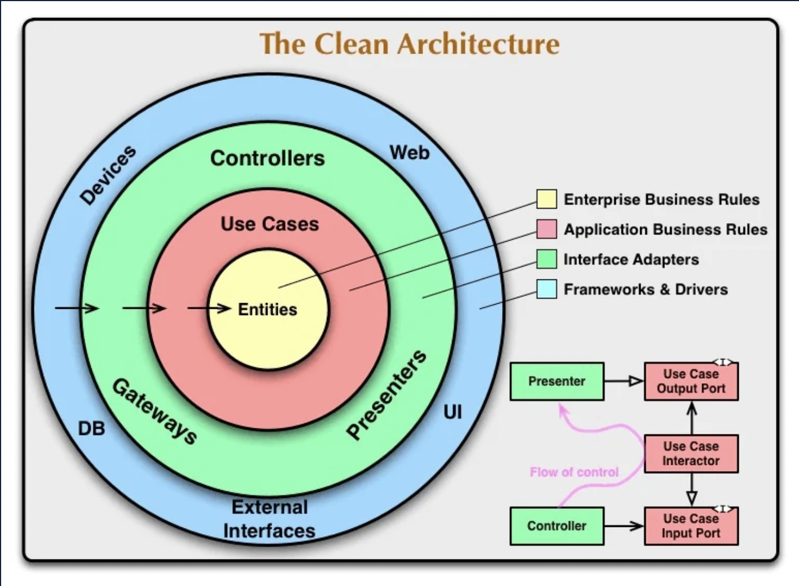
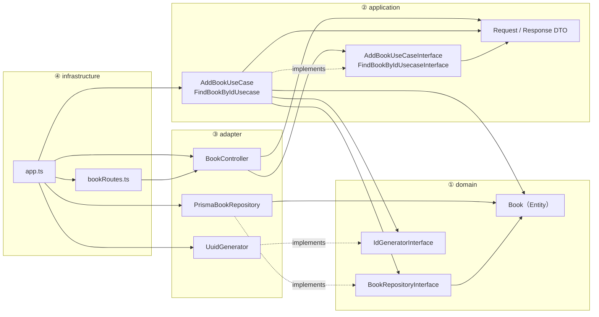
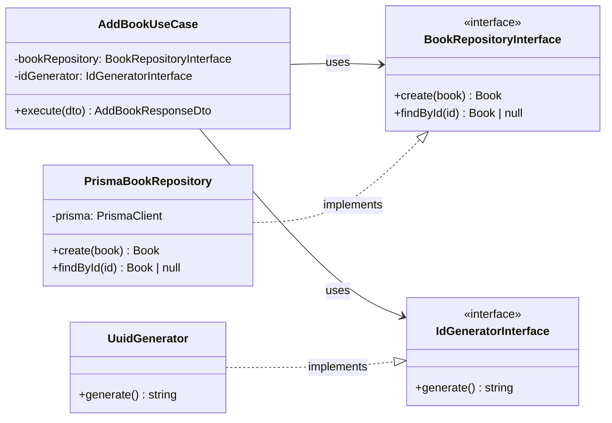
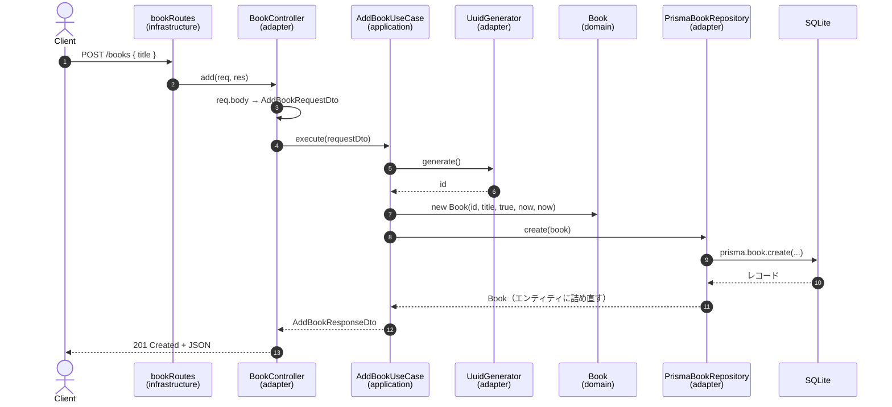
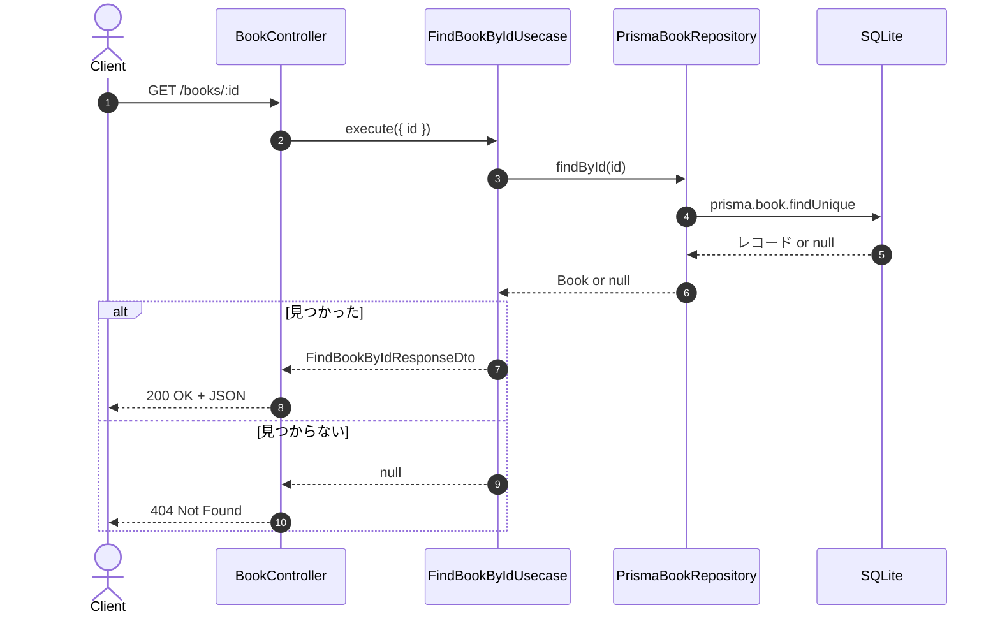

# クリーンアーキテクチャ まとめ

書籍管理 API（書籍の登録・ID検索）を題材に、クリーンアーキテクチャの考え方と、このディレクトリでの実装方法をまとめる。

ファイルごとの詳しい解説は [書籍登録（addBook）をファイルごとに読む](add-book-walkthrough.md) を参照。

---

## 1. クリーンアーキテクチャとは

ビジネスルール（アプリの本質的なロジック）を、フレームワーク・DB・Web などの「詳細」から切り離すための設計方針。

中心となるルールはひとつだけ。

> **依存関係は常に内側（よりビジネスの本質に近い側）に向かう。**
> 内側の層は外側の層のことを一切知らない。



> 出典：Robert C. Martin, [The Clean Architecture](https://blog.cleancoder.com/uncle-bob/2012/08/13/the-clean-architecture.html)（2012）

図の左側の矢印（→ → →）が「依存の向き」を表している。外側の円は内側の円を知っていてよいが、内側の円は外側の円を知ってはいけない。

### 図の円とこのプロジェクトの対応

| 円（色） | 層の名前 | 図中のキーワード | このプロジェクト（`clean/src/`） |
| --- | --- | --- | --- |
| 🟨 黄（中心） | Enterprise Business Rules | Entities | `domain/`：`Book`、`BookRepositoryInterface`、`IdGeneratorInterface` |
| 🟥 赤 | Application Business Rules | Use Cases | `application/`：`AddBookUseCase`、`FindBookByIdUsecase`、DTO |
| 🟩 緑 | Interface Adapters | Controllers / Gateways / Presenters | `adapter/`：`BookController`、`PrismaBookRepository`（＝Gateway）、`UuidGenerator` |
| 🟦 青（外周） | Frameworks & Drivers | Web / DB / UI / Devices / External Interfaces | `infrastructure/`：Express（`app.ts`、`bookRoutes.ts`）、Prisma + SQLite |

### 何がうれしいのか

| 観点 | 効果 |
| --- | --- |
| 変更に強い | DB を SQLite → PostgreSQL、Express → Fastify に変えても、domain / application は無修正 |
| テストしやすい | UseCase はインターフェースにしか依存しないので、モックを渡すだけで単体テストできる |
| 見通しがよい | 「どこに何を書くか」が層ごとに決まっている |

---

## 2. ディレクトリ構成と層の対応

```
clean/src/
├── domain/                         ← ① Enterprise Business Rules（最も内側）
│   ├── entities/book.ts                Book エンティティ
│   ├── repositories/bookRepositoryInterface.ts   リポジトリの「契約」
│   └── utils/idGeneratorInterface.ts             ID生成の「契約」
│
├── application/                    ← ② Application Business Rules
│   ├── usecases/book/
│   │   ├── addBookUseCase.ts / addBookUseCaseInterface.ts
│   │   └── findBookByIdUsecase.ts / findBookByIdUsecaseInterface.ts
│   └── dtos/book/                      入出力の型（Request / Response DTO）
│
├── adapter/                        ← ③ Interface Adapters
│   ├── controllers/bookController.ts   HTTP ⇔ UseCase の変換
│   ├── repositories/prismaBookRepository.ts   Prisma による永続化の実装
│   └── utils/uuidGenerator.ts          uuid ライブラリによる ID 生成の実装
│
└── infrastructure/                 ← ④ Frameworks & Drivers（最も外側）
    └── web/
        ├── app.ts                      Express 起動 + 依存の組み立て（DI）
        └── routers/bookRoutes.ts       URL とコントローラの対応付け
```

---

## 3. 各層の役割

### ① Domain 層（Enterprise Business Rules）

**アプリの「業務そのもの」のルールを表す層。** 何にも依存しない。

| ファイル | 役割 |
| --- | --- |
| `entities/book.ts` | 書籍エンティティ。状態（`isAvailable` など）と、それを変更するルール（`loan()` / `return()`）を持つ |
| `repositories/bookRepositoryInterface.ts` | 「書籍を保存・取得できること」という**契約だけ**を定義。実装は持たない |
| `utils/idGeneratorInterface.ts` | 「ID を生成できること」という契約 |

```ts
// 貸出中の本はさらに貸し出せない ── これは DB や Web とは無関係な業務ルール
loan() {
    if (!this._isAvailable) {
        throw new Error("Book is not available for loan.");
    }
    this._isAvailable = false;
    this._updatedAt = new Date();
}
```

- ✅ 書くもの：エンティティ、値オブジェクト、業務ルール、リポジトリのインターフェース
- ❌ 書かないもの：`import express`、`import { PrismaClient }`、`uuid` などの外部ライブラリ

### ② Application 層（Application Business Rules）

**「このアプリで何ができるか」＝ユースケースを表す層。** Domain 層だけに依存する。

| ファイル | 役割 |
| --- | --- |
| `usecases/book/addBookUseCase.ts` | 「書籍を登録する」手順：ID 生成 → Book 生成 → 保存 → DTO で返却 |
| `usecases/book/findBookByIdUsecase.ts` | 「ID で書籍を探す」手順：取得 → 見つからなければ `null` → DTO で返却 |
| `usecases/book/*Interface.ts` | ユースケースの入出力の契約。Controller はこちらに依存する |
| `dtos/book/*.ts` | ユースケースの入力（Request DTO）と出力（Response DTO）の型 |

```ts
export class AddBookUseCase implements AddBookUseCaseInterface {
    constructor(
        private readonly bookRepository: BookRepositoryInterface, // ← 実装ではなく I/F
        private readonly idGenerator: IdGeneratorInterface        // ← 実装ではなく I/F
    ) {}
    ...
}
```

ポイント：

- UseCase は `PrismaBookRepository` や `UuidGenerator` を**知らない**。インターフェースだけを知っている。
- エンティティ（`Book`）をそのまま外に返さず、**DTO に詰め替えて返す**。外側の層がエンティティの内部構造に依存しないようにするため。

### ③ Adapter 層（Interface Adapters）

**外の世界の形式と、内側（UseCase / Entity）の形式を相互に変換する層。**

| ファイル | 変換の向き | 役割 |
| --- | --- | --- |
| `controllers/bookController.ts` | HTTP → UseCase → HTTP | `req.body` / `req.params` から Request DTO を作り、UseCase を呼び、結果を HTTP ステータス（201 / 200 / 404 / 500）に変換 |
| `repositories/prismaBookRepository.ts` | Entity ⇔ DB レコード | `BookRepositoryInterface` を Prisma で実装。DB の行を `Book` エンティティに詰め直して返す |
| `utils/uuidGenerator.ts` | — | `IdGeneratorInterface` を `uuid` ライブラリで実装 |

### ④ Infrastructure 層（Frameworks & Drivers）

**フレームワークやツールそのものと、アプリの起動処理を置く層。**

| ファイル | 役割 |
| --- | --- |
| `web/app.ts` | Express の起動。**すべての具象クラスを `new` して組み立てる場所（Composition Root）** |
| `web/routers/bookRoutes.ts` | `POST /books` → `add`、`GET /books/:id` → `findById` の対応付け |

```ts
// app.ts ── 依存性の注入（DI）はここに集約されている
const prisma = new PrismaClient();
const uuidGenerator = new UuidGenerator();

const bookRepository      = new PrismaBookRepository(prisma);
const addBookUseCase      = new AddBookUseCase(bookRepository, uuidGenerator);
const findBookByIdUseCase = new FindBookByIdUsecase(bookRepository);
const bookController      = new BookController(addBookUseCase, findBookByIdUseCase);
```

「どの実装を使うか」を決めているのはここだけ。テスト時や DB 変更時はここを差し替えればよい。

---

## 4. 依存関係の図

クラス同士の `import` の向きを図にすると、すべての矢印が内側（Domain）に向かっていることがわかる。



---

## 5. 依存性逆転の原則（DIP）— 内側が外側を呼べる仕組み

処理の流れとしては「UseCase → DB への保存」と内側から外側を呼んでいる。
それなのに、なぜ UseCase は Prisma に依存せずに済むのか？

**インターフェースを内側（domain）に置き、外側（adapter）がそれを実装する**からである。

```
  【処理の流れ（実行時）】
  AddBookUseCase ──────────── 呼び出す ───────────▶ PrismaBookRepository ──▶ DB

  【ソースコードの依存（import）】
  AddBookUseCase ──▶ BookRepositoryInterface ◀── PrismaBookRepository
   (application)         (domain)                      (adapter)
                            ▲
                            └ 両方ともこの「契約」に依存する。
                              矢印はどちらも内側を向いている。
```



`IdGeneratorInterface` も同じ考え方。UseCase は「ID を作れる何か」を受け取るだけなので、テストでは固定 ID を返すモックを渡せる。

### 図の右下：Input Port / Output Port

冒頭の図の右下にある小さな図は、Controller と UseCase の境界にも同じ仕組み（依存性逆転）を使うことを表している。

```
   Controller ─────────▶ «I» Use Case Input Port
   (緑：adapter)                 ▲
                                 │ implements
                         Use Case Interactor
                         (赤：application)
                                 │ uses
                                 ▼
   Presenter ─────────▷ «I» Use Case Output Port
   (緑：adapter)  implements

   処理の流れ（Flow of control）：Controller → Interactor → Presenter
   ソースの依存：すべて赤（Use Cases）側のインターフェースに向かう
```

| 図の要素 | 役割 | このプロジェクト |
| --- | --- | --- |
| Controller | 入力を受け取り Input Port を呼ぶ | `BookController` |
| Use Case Input Port «I» | UseCase の入口の契約 | `AddBookUseCaseInterface`、`FindBookByIdUsecaseInterface` |
| Use Case Interactor | ユースケースの実装 | `AddBookUseCase`、`FindBookByIdUsecase` |
| Use Case Output Port «I» | 結果を渡す出口の契約 | **なし**（代わりに Response DTO を `return` している） |
| Presenter | 結果を表示用の形に変換する | **なし**（`BookController` が `res.status().json()` まで担当） |

このプロジェクトは、Output Port と Presenter を省いた**簡略版**になっている。UseCase が DTO を戻り値として返し、Controller が HTTP レスポンスへの変換まで行う。小さな API ではこれで十分なことが多い。表示形式が複数ある場合（JSON と HTML など）は、図のとおり Presenter を分けると UseCase を変えずに出力形式を増やせる。

---

## 6. リクエストの流れ

### 書籍の登録：`POST /books`



### 書籍の取得：`GET /books/:id`



### データの形の変化

各層の境界で、データは「その層にふさわしい形」に変換される。

```
 HTTP Request      Request DTO        Book Entity        DB Record
 (req.body)   ──▶  {title}       ──▶  new Book(...)  ──▶  prisma.book
   Controller が変換   UseCase が変換      Repository が変換

 HTTP Response     Response DTO       Book Entity        DB Record
 (res.json)   ◀──  {id,title,...} ◀── Book           ◀──  prisma.book
```

---

## 7. レイヤードアーキテクチャとの比較

同じリポジトリの `layered/`・`layered_refac/` との違い。

```
  レイヤード                         クリーン
  ┌──────────────┐                  ┌──────────────┐
  │ Presentation │                  │ Controller   │ adapter
  └──────┬───────┘                  └──────┬───────┘
         ▼                                 ▼
  ┌──────────────┐                  ┌──────────────┐
  │ BusinessLogic│                  │ UseCase      │ application
  └──────┬───────┘                  └──────┬───────┘
         ▼                                 ▼
  ┌──────────────┐                  ┌──────────────────────┐
  │ DataAccess   │                  │ Entity / Repo I/F    │ domain  ← 中心
  └──────┬───────┘                  └──────────────────────┘
         ▼                                 ▲
       【DB】 ← 最下層が土台               │ implements
                                    ┌──────┴───────┐
                                    │ Prisma Repo  │ adapter
                                    └──────────────┘
```

| 観点 | レイヤード | クリーン |
| --- | --- | --- |
| 中心にあるもの | データアクセス層（DB）が土台 | ドメイン（業務ルール）が中心 |
| 依存の向き | 上 → 下（ビジネスロジックが DB 層に依存） | 外 → 内（DB 実装がドメインに依存） |
| リポジトリ I/F の置き場所 | dataAccess 層（`layered_refac`） | **domain 層** |
| 業務ルールの置き場所 | Service にまとまりがち | Entity（`Book.loan()` など）と UseCase に分離 |
| 入出力 | エンティティ/モデルをそのまま返しがち | DTO で境界を明確化 |

---

## 8. 各層に書くもの・書かないもの チートシート

| 層 | ディレクトリ | 書くもの | 依存してよい先 |
| --- | --- | --- | --- |
| ① Enterprise Business Rules | `domain/` | Entity、業務ルール、Repository I/F | なし |
| ② Application Business Rules | `application/` | UseCase、UseCase I/F、DTO | domain |
| ③ Interface Adapters | `adapter/` | Controller、Repository 実装、外部ライブラリのラッパー | application, domain（+ 必要なライブラリ） |
| ④ Frameworks & Drivers | `infrastructure/` | Web サーバ起動、ルーティング、DI の組み立て | すべて |

**迷ったときの判断基準**

- その処理は「DB や Web が変わっても変わらないか？」 → Yes なら domain / application
- その処理は「外部の形式と内部の形式の変換か？」 → adapter
- その処理は「特定のフレームワークの設定・起動か？」 → infrastructure

---

## 9. 動かし方

```bash
cd clean
npm install
npx prisma migrate dev   # DATABASE_URL を .env に設定しておく
npm run dev              # http://localhost:3000

# 書籍の登録
curl -X POST http://localhost:3000/books \
  -H "Content-Type: application/json" \
  -d '{"title": "Clean Architecture"}'

# 書籍の取得
curl http://localhost:3000/books/<id>
```
